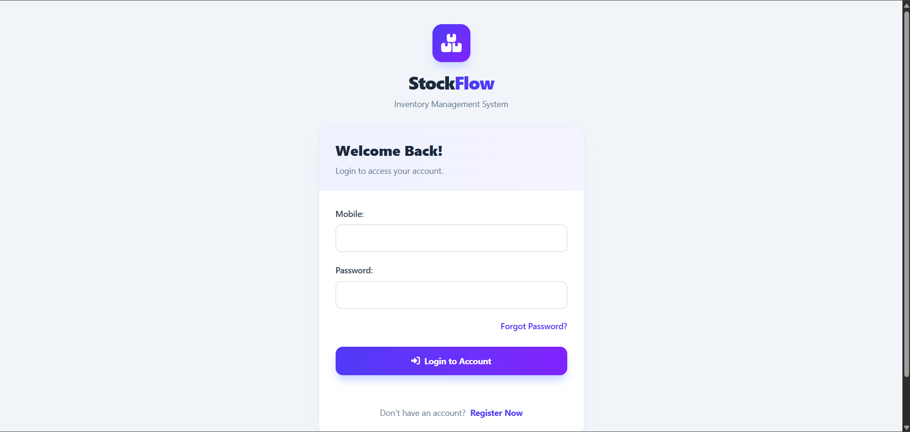
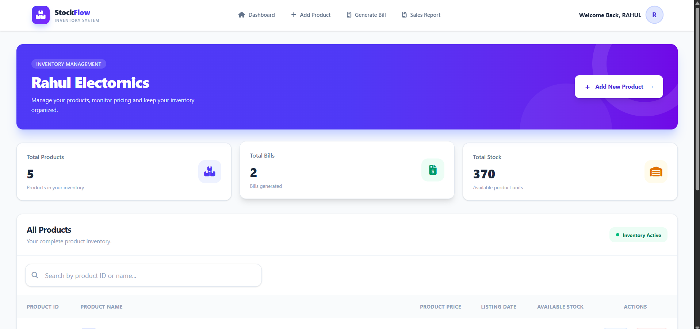
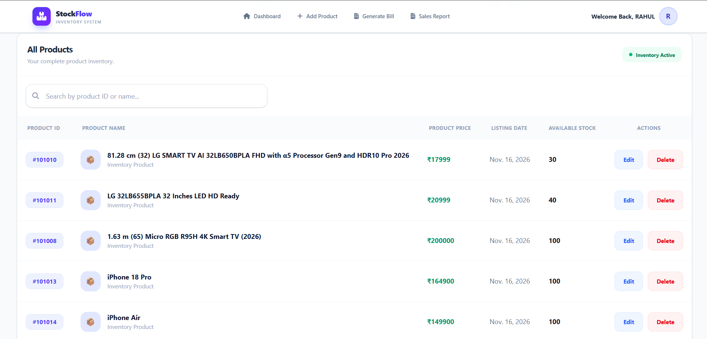
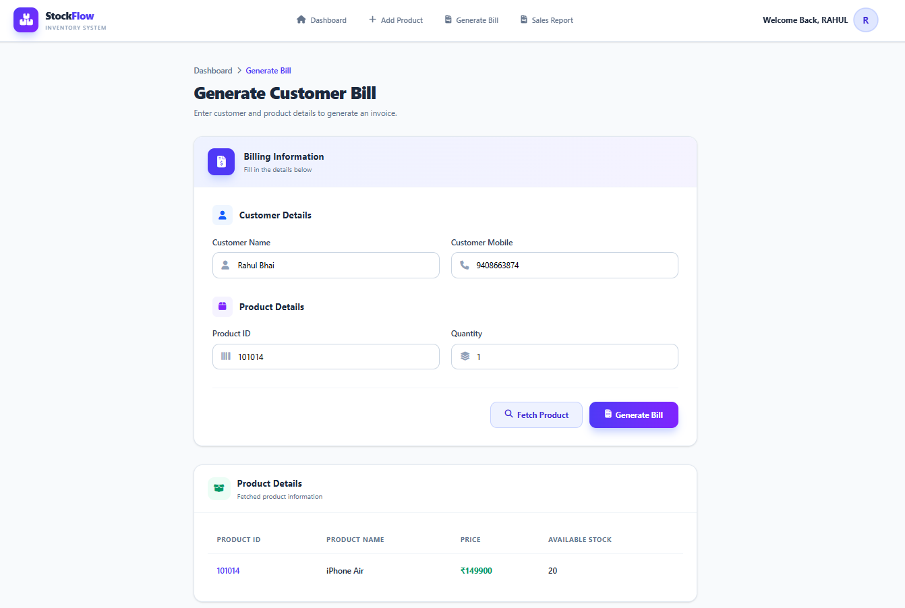
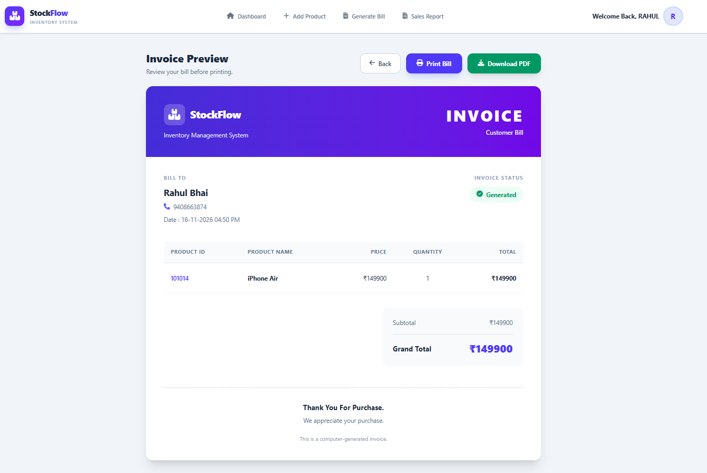
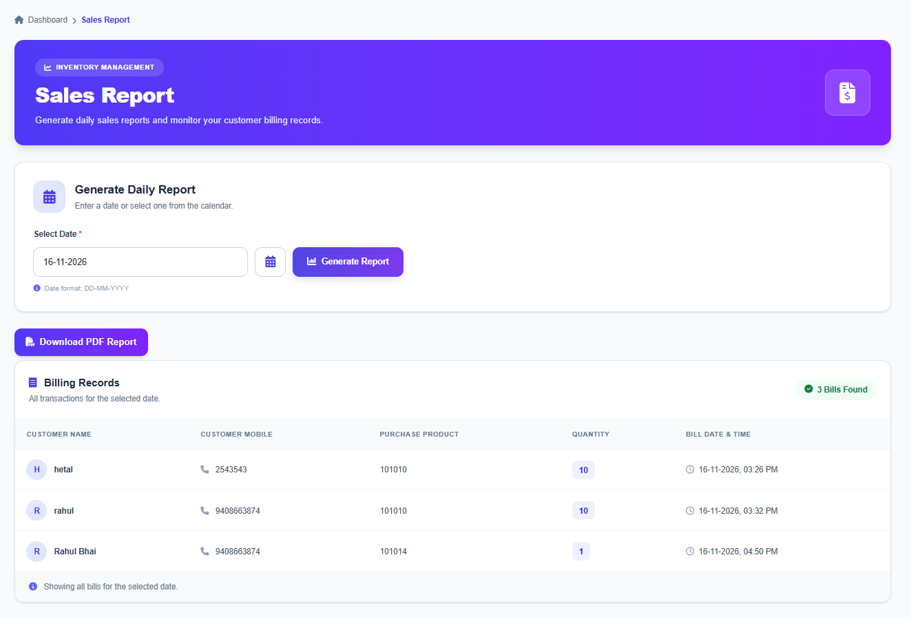

# StockFlow – Inventory Management System

StockFlow is a web-based Inventory Management System built with Django and MySQL. It helps users manage products, monitor available stock, generate customer bills, and view sales reports through a simple interface.

## Features

- User Registration and Login
- User-specific Inventory Management
- Add, View, Update and Delete Products
- Search Products by Product ID or Product Name
- Track Available Product Stock
- Generate Customer Bills
- Automatic Stock Updates after Billing
- Sales Reports
- Responsive User Interface

## Tech Stack

| Technology | Purpose |
|---|---|
| Python | Backend programming |
| Django | Web framework |
| MySQL | Database |
| HTML | Page structure |
| Tailwind CSS | Styling |
| JavaScript | Interactive search |
| Git & GitHub | Version control |

## Project Structure

```text
StockFlow/
├── inventory_system/
│   ├── settings.py
│   ├── urls.py
│   ├── asgi.py
│   └── wsgi.py
├── mainapp/
│   ├── migrations/
│   ├── static/
│   ├── templates/
│   ├── models.py
│   ├── form.py
│   ├── urls.py
│   └── views.py
├── manage.py
├── requirements.txt
├── package.json
├── package-lock.json
├── .env.example
└── .gitignore
```

## Requirements

Before running the project, install:

- Python
- MySQL Server
- Git

## Installation and Setup

### 1. Clone the repository

```bash
git clone https://github.com/rahulprajapati1826/StockFlow.git
cd StockFlow
```

### 2. Create a virtual environment

```bash
python -m venv venv
```

Activate it on Windows:

```powershell
venv\Scripts\activate
```

### 3. Install Python dependencies

```bash
pip install -r requirements.txt
```

### 4. Create a MySQL database

Open MySQL Workbench or MySQL command line and run:

```sql
CREATE DATABASE your_database_name;
```

### 5. Configure environment variables

Create a `.env` file in the project root using `.env.example` as a reference.

Add your own values:

```env
DJANGO_SECRET_KEY=your_secret_key
DJANGO_DEBUG=True

DB_NAME=your_database_name
DB_USER=root
DB_PASSWORD=your_mysql_password
DB_HOST=localhost
DB_PORT=3306
```

Do not upload your actual `.env` file or database credentials to GitHub.

### 6. Apply database migrations

```bash
python manage.py migrate
```

### 7. Run the development server

```bash
python manage.py runserver
```

Open the application:

```text
http://127.0.0.1:8000/
```

## Screenshots

### Login Page


### Dashboard


### All Products


### Billing Page


### Billing Page


### Sales Report


## Author

Rahul Prajapati

## Repository

[StockFlow on GitHub](https://github.com/rahulprajapati1826/StockFlow)